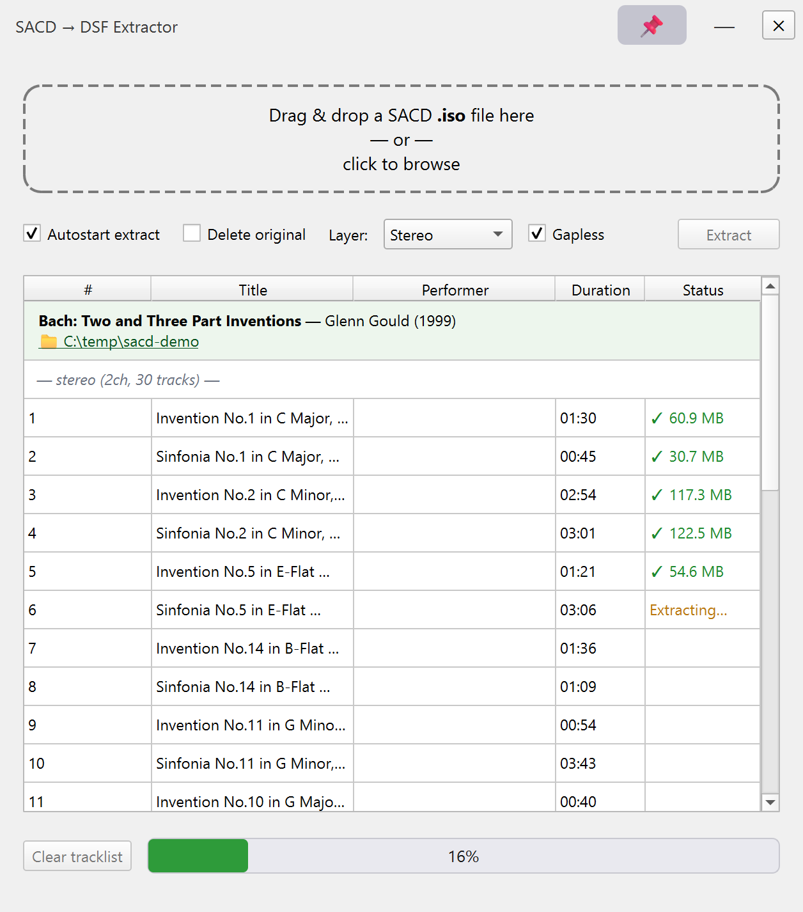

# SACD ISO → DSF Extractor

A small desktop app that splits a SACD `.iso` image into individual **DSF**
track files. Drop a file onto the window and extraction starts right away;
the finished tracks land in a new folder next to the source ISO.



## Features

- Drag & drop (or click to browse), track list with live progress and log.
- Stereo, multi-channel, or both layers; optional gapless (no zero-pad) output.
- **Clear tracklist** button to start over; it also resets the progress bar.
- Optional deletion of the source ISO after a successful extraction.
- Damaged sectors are skipped with a warning instead of aborting the whole disc.
- Resizable window; runs as a self-contained Windows executable.

## How it works

```
sacd_tool/    Rust helper CLI (list metadata + extract DSF)
sacd_gui/     PySide6 front-end that runs the helper in the background
```

The helper prints one JSON object per line (`album`, `track_start`,
`track_done`, `error`, `warning`, …) so the GUI can show live progress.

## Using it

1. Run `sacd_gui/dist/SACD-Extractor.exe`, or start from source with
   `python sacd_gui/app.py`.
2. Drop a SACD `.iso` onto the drop area (or click to browse).
3. With **Autostart extract** ticked (default) extraction begins as soon as
   the track list appears; otherwise press **Extract**.
4. Tracks are written to `<source folder>/<album name>/`.

## Building from source

Requirements: Rust toolchain (`cargo`), Python 3, `pip install PySide6 pyinstaller`.

```powershell
cd sacd_gui
pwsh -File build_windows.ps1      # cargo build --release + PyInstaller
# -> sacd_gui/dist/SACD-Extractor.exe
```

Run the sources directly with `cargo build --release` in `sacd_tool/` and
then `python sacd_gui/app.py`. The GUI finds the helper via the `SACD_TOOL`
environment variable, a bundled `tool/` directory, the local
`sacd_tool/target/release` build, or `PATH`.

## Credits

The SACD parsing, DST decompression and DSF writing logic comes from the
open-source [`sacd-rs`](https://github.com/bleggett/sacd-rs) project.
